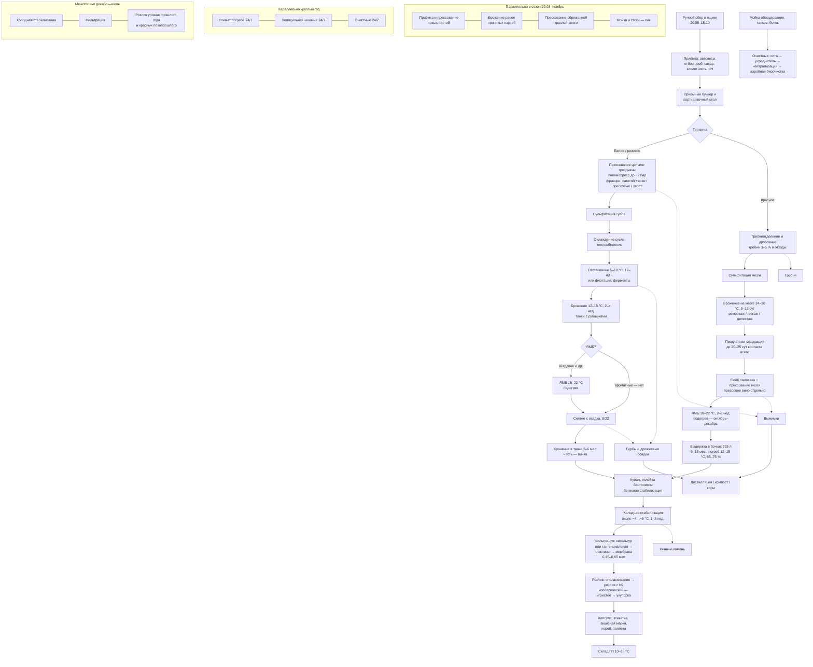

# 02. Технология винодельни полного цикла (≈300 т винограда за сезон)

Дата: 16.11.2026. Цель раздела: описать технологическую цепочку нового завода (вино из собственного винограда) так, чтобы по ней можно было составить перечень электроприёмников и графики нагрузок.

**Как читать статусы.**
- **ПОДТВЕРЖДЕНО** — есть источник именно по Arba Wine.
- **ТИПОВОЕ** — данные из учебной, отраслевой литературы или каталога производителя.
- **РАСЧЁТНОЕ** — посчитано здесь, формула приведена.
- **НЕИЗВЕСТНО** — данных нет.

Для некоторых цифр ниже стоит пометка «ТИПОВОЕ, первоисточник не сверен». Это общепринятые в практике значения, для которых в ходе проверки не найден открытый первоисточник с номером страницы. Перед защитой их нужно сверить с учебником (Валуйко, Ribéreau-Gayon, Boulton et al.).

**Важно.** Arba Wine здесь только технологический аналог. Его данные не являются данными нового завода. Сведения об Arba ниже — только те, что опубликованы на сайте arbawine.com и в СМИ (проверено 16.11.2026).

Номера источников в квадратных скобках ведут к списку в разделе 9.

---

## 0. Что известно о технологии Arba Wine (ПОДТВЕРЖДЕНО)

| Этап | Что опубликовано | Источник |
|---|---|---|
| Сбор | Вручную. Сезон примерно с 20 августа до середины октября; в это время завод работает «практически круглосуточно» | [A2] |
| Работы на винограднике | Все работы ручные, от ранней весны до зимы; машинные технологии отвергнуты | [A5] |
| Сортировка и гребнеотделение | Оборудование «известной швейцарской фирмы» для сортировки гроздей и отделения ягод от гребня. Марка не названа | [A5] |
| Прессование | Пневматические прессы Bucher Vaslin для белого винограда | [A1], [A5] |
| Брожение | Танки из нержавеющей стали с «рубашками охлаждения»; ферментационные ёмкости и танки высокого давления Gortani (Италия). Лёгкие ароматные белые (Рислинг, Гевюрцтраминер) бродят в охлаждаемых танках. Дубовые чаны Garbelotto для особых красных | [A1], [A3], [A5] |
| Холод | Чиллеры с контроллерами на рубашках танков и на корпусах бочек; в помещениях компрессорные системы «охлаждение/обогрев». Температура для белых и красных разная, значения не приводятся | [A1] |
| Перекачка | Безмасляный насос CSF A LOBI B215-3200, до 10 000 л/ч, с датчиком скорости прокачки через фильтры | [A1] |
| Фильтрация | Двойная очистка; перед розливом — макрофильтр Spadoni MAC10 (частицы более 20 мкм) | [A1] |
| Выдержка | Бочки французских и итальянских производителей, дуб из центра Франции. Погреб с «определённой температурой и влажностью»; климат-контроль проверяют 3 раза в сутки. Бутылочный погреб 61,4 м². Объём бочек, их число и сроки выдержки не указаны | [A3] |
| Розлив | Моноблок Alfatek QBS-V ISO 12/12/1/1: 2 500 бут./ч, подача азота против окисления; натуральная, винтовая и шампанская пробка | [A4] |
| Мойка бутылок | Omar R&G OPTIMA1-1212: наружная очистка и вакуумная сушка | [A4] |
| Укупорка и оформление | Пробки Amorim; капсулятор Robino & Galandrino MINIBLOC OTTICO (термоколокол); этикетировщик Cavagnino & Gatti CG80-5-2C-1RPS-SFG (этикетка, контрэтикетка, акцизная марка, датировка) | [A4] |
| Ассортимент | Сухие белые и красные, игристое, сидр. Около 15 сортов | [A5] и 01_Предприятия.md |
| Объём переработки, температуры, длительности, выходы, ёмкости, стоки, отходы | **НЕИЗВЕСТНО** — не публикуются | — |

---

## 1. Этапы технологии

Обозначения в столбце «Электрика»:
- **Д** — двигательная нагрузка (насос, привод, вентилятор);
- **К** — компрессорная нагрузка (холодильная машина или чиллер, воздушный компрессор);
- **Т** — нагрев (ТЭН, электрокотёл, тепловой насос);
- **ПК** — повторно-кратковременный режим;
- **Дл** — длительный режим.

### 1.1. Сбор винограда

| Пункт | Содержание |
|---|---|
| Цель | Снять виноград в технической зрелости, не повредив ягоды, и быстро доставить его на завод |
| Как выполняется | Для премиальных вин — ручной сбор в ящики. Машинный сбор — комбайн, ягода без гребня, высокая доля сока в бункере |
| Параметры | Время от среза до переработки — как можно короче. Пример аналога из того же района: на Тургеньском заводе АО «Голд Продукт» виноград поступает через 1–1,5 ч после сбора (01_Предприятия.md, ПОДТВЕРЖДЕНО для Голд Продукт). Ящики 15–20 кг, слой винограда не более 30–40 см — ТИПОВОЕ, первоисточник не сверен. Температура винограда при поступлении в августе–сентябре обычно 20–30 °C, поэтому для белых сортов выгоден утренний сбор или охлаждение массы до прессования — ТИПОВОЕ, первоисточник не сверен |
| Оборудование | Транспорт (тракторные тележки, грузовики), пластиковые ящики. Электрическая нагрузка на заводе отсутствует |
| Arba Wine | Ручной сбор, сезон с ≈20.08 до середины октября, сухая погода [A2] (ПОДТВЕРЖДЕНО). Ящики и время доставки — НЕИЗВЕСТНО |

### 1.2. Приёмка, взвешивание, отбор проб

| Пункт | Содержание |
|---|---|
| Цель | Учесть массу, оценить качество партии, принять решение о направлении переработки (белое, красное, игристое) |
| Как выполняется | Взвешивание машины брутто и нетто на автовесах или ящиков на платформенных весах. Средняя проба: сахаристость (рефрактометр или ареометр, °Brix или г/дм³), титруемая кислотность, pH, визуальная оценка гнили |
| Параметры | Ориентиры для сухих тихих вин — сахаристость 19–24 °Brix (≈190–250 г/дм³), титруемая кислотность 6–9 г/дм³, pH 3,1–3,5. ТИПОВОЕ, первоисточник не сверен; для диплома достаточно как ориентир |
| Оборудование | Автовесы (тензодатчики, терминал — небольшая нагрузка, 0,1–0,5 кВт); платформенные весы; лабораторное оборудование: рефрактометр, pH-метр, титратор, термостат, холодильник (однофазная нагрузка, Дл) |
| Arba Wine | НЕИЗВЕСТНО |

### 1.3. Сортировка

| Пункт | Содержание |
|---|---|
| Цель | Удалить гниль, листья, недозрелые грозди и посторонние предметы |
| Как выполняется | Приёмный бункер со шнеком или вибролоток, затем сортировочный стол (ручная сортировка гроздей). После гребнеотделения возможна вторая сортировка ягод на вибростоле или оптическом сортировщике |
| Параметры | Производительность сортировочного стола 2–5 т/ч при 4–8 сортировщиках — ТИПОВОЕ, уточнить по каталогу подобранной модели |
| Оборудование | Приёмный бункер со шнеком (Д, ПК), ленточный или вибрационный стол (Д, Дл в часы приёмки), оптический сортировщик (камера, компьютер, пневмоклапаны, то есть нужен сжатый воздух — К), мойка ящиков (насос высокого давления — Д) |
| Arba Wine | Сортировка гроздей на оборудовании швейцарской фирмы, марка не названа [A5] (ПОДТВЕРЖДЕНО, без модели) |

### 1.4. Гребнеотделение и дробление

| Пункт | Содержание |
|---|---|
| Цель | Отделить гребни, которые дают травянистые и горькие тона, и при необходимости раздавить ягоды |
| Как выполняется | Красные — всегда гребнеотделение с лёгким дроблением, затем мезга в бродильный танк. Белые премиального уровня — прессование целыми гроздьями, без гребнеотделения. Второй вариант для белых — гребнеотделение без дробления и прессование ягоды |
| Параметры | Гребни — 3–5 % массы винограда (в опыте UC Davis с Гренашем 3,4 %) [L5] — ТИПОВОЕ |
| Оборудование | Гребнеотделитель-дробилка (Д, ПК, обычно с частотным приводом); насос мезги — винтовой, перистальтический или поршневой (Д, ПК); ленточный транспортёр гребней (Д) |
| Arba Wine | Отделение ягод от гребня на швейцарском оборудовании [A5] (ПОДТВЕРЖДЕНО, без модели) |

### 1.5. Сульфитация

| Пункт | Содержание |
|---|---|
| Цель | Антисептик, антиоксидант, отбор дрожжей; для красных также лучшая экстракция антоцианов |
| Как выполняется | Раствор SO₂ или метабисульфит калия вносят при дроблении или сразу после него — так предписывает OIV [L1, лист 2.1.2, с. II.2.1-7]. Дозатор при гребнеотделителе или ручное внесение |
| Параметры | Доза на виноград и сусло 30–80 мг/дм³ в зависимости от санитарного состояния, pH и температуры; для здорового винограда — нижняя граница. ТИПОВОЕ, первоисточник не сверен. Предел общего SO₂ в готовом вине по OIV: 150 мг/л для красных, 200 мг/л для белых и розовых, 300 мг/л при сахаре более 4 г/л [L1, лист 1.12 / таблица добавок] — ТИПОВОЕ (норма) |
| Оборудование | Дозирующий насос (≤0,1 кВт, Д, ПК) — по мощности незначим |
| Arba Wine | НЕИЗВЕСТНО |

### 1.6. Прессование

| Пункт | Содержание |
|---|---|
| Цель | Белые и розовые: получить сусло до брожения с отбором фракций. Красные: отжать сброженную мезгу после мацерации |
| Как выполняется | Пневматический мембранный пресс с программами циклов: подъём давления → выдержка → сброс → поворот барабана для разрыхления. Фракции: самотёк (стекает при заполнении пресса), «кюве» при низком давлении, прессовые фракции, последняя (хвостовая) фракция. Для красных — самотёчное вино сливают из танка, мезгу прессуют, прессовое вино хранят отдельно |
| Параметры | Рабочее давление пневмопресса до 2 бар (Bucher XPro) [L8]. Сусло последних фракций (примерно от 1,5 бар) отличается составом: больше катехинов и фенолов, сильнее окисляется. Поэтому его часто отделяют от основного [L9]. Загрузка (Bucher XPro 5/8/15): целые грозди 300/480/900 кг; ягода без гребня 800/1 280/2 400 кг; сброженная мезга 1 500/2 400/4 500 кг [L8]. Мощность в той же таблице 1,5/2,8/4,4 кВт; XPro 5 и 8 однофазные 230 В, XPro 15 трёхфазный 400 В [L8] — ТИПОВОЕ (каталог). Длительность цикла: целые грозди около 2–3 ч, ягода 1,5–2 ч, сброженная мезга 1–1,5 ч — ТИПОВОЕ, первоисточник не сверен; уточнить по паспорту выбранного пресса. Выход по фракциям — см. раздел 3 |
| Оборудование | Пневмопресс: привод барабана, встроенный компрессор или воздуходувка для мембраны, вакуумный насос (Д + К, ПК, циклический график). Насос сусла или вина из поддона (Д). Транспортёр выжимок (Д) |
| Arba Wine | Пневмопрессы Bucher Vaslin для белого винограда [A1], [A5] (ПОДТВЕРЖДЕНО; модели и число прессов — НЕИЗВЕСТНО) |

### 1.7. Подготовка сусла (белые и розовые)

| Пункт | Содержание |
|---|---|
| Цель | Осветлить сусло перед брожением (отделить «бурбы» — взвесь), скорректировать состав |
| Как выполняется | (а) Отстаивание на холоде (дебурбаж): сусло охлаждают, вносят пектолитические ферменты, отстаивают и снимают с осадка. (б) Флотация: азот или воздух и флокулянт, непрерывный процесс; применение по OIV — лист 2.1.14 [L1]. (в) Корректировки в пределах OIV: подкисление, азотное питание для дрожжей. Отстаивание сусла — OIV, лист 2.1.5; ферменты для осветления — лист 2.1.4 [L1] |
| Параметры | Отстаивание при 5–10 °C в течение 12–48 ч; при низкой температуре ферменты работают медленнее, и их дозу корректируют — ТИПОВОЕ, первоисточник не сверен. Объём бурбяных осадков 2–5 % объёма сусла — ТИПОВОЕ, первоисточник не сверен. При отстаивании иногда нужна лёгкая обработка бентонитом |
| Оборудование | Танки с рубашками и подачей холодного гликоля (К — нагрузка на центральную холодильную машину, Дл). Теплообменник «труба в трубе» для быстрого охлаждения сусла после пресса — пиковая нагрузка на холод в сезон. Флотатор: насос, сатуратор, компрессор (Д + К). Фильтр для бурбяных осадков (вакуумный барабанный — Д + вакуумный насос, или фильтр-пресс) |
| Arba Wine | НЕИЗВЕСТНО (есть только общая фраза о постоянном охлаждении соков в танках с рубашками [A1]) |

### 1.8. Спиртовое брожение белых

| Пункт | Содержание |
|---|---|
| Цель | Сбродить сахар до сухого вина и сохранить первичный аромат |
| Как выполняется | Брожение в танках из нержавеющей стали с рубашками охлаждения. Часть вин бродит в бочках при регулировании температуры помещения |
| Параметры | 12–18 °C. Ниже 10 °C брожение может остановиться, выше 20 °C теряется аромат — ТИПОВОЕ, учебные материалы; первоисточник не сверен. Длительность 10–30 сут (2–4 недели) — ТИПОВОЕ, первоисточник не сверен. Брожение выделяет тепло: без отвода тепла сусло разогревается, нагрузка на холод максимальна в бурную фазу. Тепловой расчёт — [05_Расчет_производительности.xlsx](05_Расчет_производительности.xlsx), лист «Сценарии», и [03_Ведомость_электроприемников.xlsx](03_Ведомость_электроприемников.xlsx), лист «Чиллеры» |
| Оборудование | Танки с рубашками, датчиками и электромагнитными клапанами (контроллеры — малая нагрузка). Центральная холодильная машина или чиллер гликоля (К, Дл, максимум в сентябре–октябре). Циркуляционные насосы гликоля (Д, Дл) |
| Arba Wine | Лёгкие ароматные белые бродят в охлаждаемых танках из нержавеющей стали [A5]; рубашки и чиллеры [A1] (ПОДТВЕРЖДЕНО). Температуры — НЕИЗВЕСТНО |

### 1.9. Брожение красных на мезге и мацерация

| Пункт | Содержание |
|---|---|
| Цель | Извлечь из кожицы цвет, танины и аромат; сбродить сахар |
| Как выполняется | Мезгу закачивают в открытый или закрытый танк. «Шапку» мезги регулярно разрушают: ремонтаж (перекачка сусла из-под шапки на шапку), пижаж (притапливание шапки, ручное или механическое), делестаж (слив сусла и возврат). После брожения возможна продлённая мацерация, затем слив самотёка и прессование мезги |
| Параметры | Брожение красных ведут в широком диапазоне. Лёгкие фруктовые вина — 20–25 °C. Полнотелые (Каберне Совиньон на Западном побережье США) — 28–35 °C [L6, с. 3]. В опыте AWRI: контроль 24–26 °C, брожение 10–12 сут; «тёплый» вариант 24–32 °C, 7 сут [L7]. Выше 35 °C есть риск остановки брожения [L10]. Самый эффективный способ охлаждения — прокачка через теплообменник с подачей на шапку [L10]. Ремонтаж обычно 1–2 раза в начале, пижаж около 2 раз в сутки [L6]. Общая длительность контакта с мезгой в Бордо обычно 20–25 сут; в США вино часто прессуют через 10–15 сут после окончания брожения [L6]. Продлённая мацерация до 21–60 сут в опытах AWRI [L11] — ТИПОВОЕ |
| Оборудование | Ремонтажный насос (центробежный или импеллерный, Д, ПК — несколько раз в сутки по 15–60 мин). Механический пижер (Д, ПК). Танки с рубашками (К). Переносной теплообменник. Насос мезги или выгрузка мезги в пресс (Д). Дубовые чаны |
| Arba Wine | Ферментационные ёмкости Gortani; дубовые чаны Garbelotto для «особых красных» [A1], [A3] (ПОДТВЕРЖДЕНО). Способ работы с шапкой, температуры и сроки — НЕИЗВЕСТНО. Стиль вина зависит от «способа ферментации, метода прессования и длительности выдержки на мезге» — общая фраза [A6] |

### 1.10. Яблочно-молочное брожение (ЯМБ)

| Пункт | Содержание |
|---|---|
| Цель | Превратить яблочную кислоту в молочную (мягче вкус), обеспечить микробиологическую стабильность. Обязательно для большинства красных, по выбору для части белых (Шардоне) |
| Как выполняется | Внесение культуры *Oenococcus oeni* после спиртового брожения или одновременно с ним. Поддержание температуры, низкий свободный SO₂ |
| Параметры | Допустимо 15–25 °C, предпочтительно 18–22 °C; нижняя граница при спирте ≥ 14 % об. Выше 25 °C ЯМБ замедляется, растёт риск порчи и летучей кислотности [L12]. Свободный SO₂ обычно держат ниже 20 мг/л [L6]. Длительность 2–8 недель — ТИПОВОЕ, первоисточник не сверен. **Для электрики:** ЯМБ приходится на октябрь–декабрь. В предгорьях (≈1000 м) в погребе и танках в это время температура ниже 18 °C, поэтому нужен **подогрев**: горячая вода в рубашки от теплового насоса или электрокотла, или обогрев помещения (Т, Дл, 24 ч/сут, ноябрь–январь) |
| Оборудование | Контур горячей воды для рубашек (электрокотёл или тепловой насос — Т/К, насос — Д). Либо обогрев помещения (электроконвекторы или кондиционеры в режиме обогрева) |
| Arba Wine | В помещениях компрессорные системы, которые «могут и охлаждать, и обогревать» [A1] (ПОДТВЕРЖДЕНО — значит, обогрев есть). О ЯМБ — НЕИЗВЕСТНО |

### 1.11. Перекачивание

| Пункт | Содержание |
|---|---|
| Цель | Переливки (снятие с осадка), подача в пресс, фильтр, на розлив |
| Как выполняется | Щадящие насосы с регулированием подачи |
| Параметры | В среднем каждый литр вина перекачивается около 10 раз за цикл производства [L3] |
| Оборудование | Импеллерные (гибкий ротор), кулачковые (лобовые), винтовые (мохно), перистальтические, поршневые — для мезги; центробежные — для ремонтажа и мойки. Передвижные, на 230/400 В, обычно 0,75–5,5 кВт. Д, ПК; нужно много розеток 400 В в цехах |
| Arba Wine | Кулачковый насос CSF A LOBI B215-3200, до 10 000 л/ч [A1] (ПОДТВЕРЖДЕНО; мощность — НЕИЗВЕСТНО) |

### 1.12. Охлаждение и термоконтроль

| Пункт | Содержание |
|---|---|
| Цель | Отвод теплоты брожения, отстаивание сусла, холодная стабилизация, климат погреба |
| Как выполняется | Центральная холодильная машина (чиллер) охлаждает водно-гликолевый или спиртовой раствор, который циркулирует по рубашкам танков. Каждый танк управляется контроллером с электромагнитным клапаном. Для быстрого охлаждения сусла — теплообменники «труба в трубе». Для погреба — сплит-системы или кондиционер с увлажнением |
| Параметры | Температура гликоля обычно −5…−10 °C (ниже для холодной стабилизации) — ТИПОВОЕ, первоисточник не сверен. **Холод — главный потребитель энергии винодельни: 40–60 % потребления.** Освещение 8–20 %, насосы, вентиляторы и приводы 10–35 %, сжатый воздух 3–10 %, розлив и упаковка 8–30 % [L4, раздел Overall economics] — ТИПОВОЕ. Это ключевая цифра для проверки будущего расчёта нагрузок |
| Оборудование | Чиллер (К, Дл, максимум в сезон брожения, второй пик — при холодной стабилизации). Насосы гликоля (Д, Дл). Вентиляторы градирни или конденсатора (Д). Важно: холодопроизводительность и потребляемая электрическая мощность — разные величины, их связывает коэффициент EER |
| Arba Wine | Чиллеры с контроллерами на рубашках танков и на бочках; компрессорные системы «холод/тепло» в помещениях [A1] (ПОДТВЕРЖДЕНО; марки, мощности — НЕИЗВЕСТНО) |

### 1.13. Выдержка и хранение

| Пункт | Содержание |
|---|---|
| Цель | Созревание вина (красные и часть белых в дубе), хранение до розлива |
| Как выполняется | Хранение в танках из нержавеющей стали под инертным газом или с доливкой. Выдержка в бочках 225 л (бордоская барик) или 228 л (бургундская) [L13]. Регулярная доливка бочек |
| Параметры | Погреб около 13 °C (55 °F) и влажность около 70 % [L13]; влажность 65–75 % названа лучшей — она уменьшает испарение, а избыток ведёт к плесени [L13]. Для выдержки вина обычно задают 12–15 °C — ТИПОВОЕ. Потери на испарение из бочек — 1–5 % объёма в год в зависимости от влажности и температуры; в качестве ориентира в одном исследовании 3 %/год в наземном шае и 1,2 %/год в подземном погребе — ТИПОВОЕ, вторичный источник, первоисточник не сверен. Доливка — от раза в неделю до раза в 6 недель — ТИПОВОЕ. Срок выдержки красных в бочках 6–18 мес. — ТИПОВОЕ. Вклад новой бочки во вкус: 1-й год ≈ 50 %, 2-й — 30 %, 3-й — 15 %, 4-й — 5 % («нейтральная») [L13] |
| Оборудование | Климат погреба: охлаждение, обогрев, увлажнитель (К + Т, Дл, 24 ч/сут, 365 сут/год). Вентиляция с датчиками CO₂ — обязательна в бродильном цехе по технике безопасности (Д). Мойка бочек горячей водой и паром: водонагреватель или парогенератор (Т, ПК), насос высокого давления (Д). Стеллажи для бочек (без нагрузки) |
| Arba Wine | Бочковый погреб с поддержанием температуры и влажности; дуб из центра Франции, сушка не менее 36 мес.; бочки французских и итальянских производителей; бутылочный погреб 61,4 м²; климат-контроль проверяется 3 раза в сутки [A3] (ПОДТВЕРЖДЕНО). Объём и число бочек, параметры климата — НЕИЗВЕСТНО |

### 1.14. Стабилизация

| Пункт | Содержание |
|---|---|
| Цель | Предотвратить выпадение винного камня (гидротартрата калия) и белковое помутнение в бутылке |
| Как выполняется | **Холодная (тартратная) стабилизация:** вино охлаждают чуть выше точки замерзания и выдерживают; вариант — «контактный» способ с внесением кристаллов. Альтернативы без холода: электродиализ, катионообмен, ингибиторы КМЦ, маннопротеины, метавинная кислота [L4], [L2]. Лист OIV 3.3.4 «Cold stabilisation treatment», с. II.3.3-6 [L1]. **Белковая стабилизация:** оклейка бентонитом по результатам теплового теста |
| Параметры | Классическая стабилизация в опытах: −4 °C, 14 и 21 сут; в первые ≈12 сут выпадение идёт быстро, потом сильно замедляется [L4]. Контактный способ: около 4 г/л кристаллов 40 мкм при 0 °C и перемешивании [L4]. Тест на стабильность (AWRI): −4 °C, 3 сут [L2]. Температуру стабилизации часто считают по эмпирической формуле t ≈ −(A/2 − 1) °C, где A — спирт, % об. (формула Перена 1977 г., цитируется в [L4]; в PDF она дана рисунком и при проверке не извлечена — ТИПОВОЕ, сверить). Для A = 12–13 % получается ≈ −5…−5,5 °C. Бентонит: часто около 1 г/л в зависимости от марки [L14]; тест на белковую стабильность — нагрев 80 °C, 2 ч [L14] — ТИПОВОЕ |
| Оборудование | Изотермические танки (с изоляцией) с рубашками. Низкотемпературный контур чиллера (К, Дл, 24 ч/сут на 1–3 недели на каждую партию; декабрь–март). Можно использовать холодный зимний воздух — в Алматинской области это снижает нагрузку. Мешалка или насос для бентонита (Д, ПК). Альтернатива: установка электродиализа (Д, ПК; без пика по холоду) |
| Arba Wine | НЕИЗВЕСТНО |

### 1.15. Фильтрация

| Пункт | Содержание |
|---|---|
| Цель | Осветление (грубое → тонкое) и стерилизующая фильтрация перед розливом |
| Как выполняется | (1) Кизельгуровый (намывной) фильтр для мутных вин и осадков. (2) Пластинчатый (картонный) фильтр — тонкая фильтрация. (3) Мембранный или картриджный фильтр 0,45–0,65 мкм непосредственно перед розливом. (4) Тангенциальный (кросс-флоу) фильтр — заменяет 1–2 ступени, работает без кизельгура. Фильтрация — листы OIV 2.1.11 (сусло) и 3.2.2 (вино) [L1] |
| Параметры | Мембрана 0,65 мкм используется в тестах на стабильность [L4]; для розлива сухих вин без консервантов — 0,45 мкм — ТИПОВОЕ. Кизельгур, попавший в канализацию, ухудшает работу очистных; места работы с ним нужно изолировать [L3] |
| Оборудование | Фильтр-насосы (Д, ПК). Тангенциальный фильтр — самый мощный из фильтров, 5–15 кВт; работает часами при подготовке партии (Д, ПК). Регенерация картриджей горячей водой (Т) |
| Arba Wine | Двойная очистка; макрофильтр Spadoni MAC10 (более 20 мкм) перед розливом [A1]. Стерилизующая ступень не описана (НЕИЗВЕСТНО) |

### 1.16. Подготовка бутылок

| Пункт | Содержание |
|---|---|
| Цель | Чистая и стерильная тара |
| Как выполняется | Для новой стеклотары обычно хватает ополаскивания: водой (возможно озонированной или стерильной) или продувки фильтрованным воздухом либо азотом. Мойка оборотной тары на малом заводе нецелесообразна |
| Параметры | ТИПОВОЕ — режимы по паспорту ополаскивателя |
| Оборудование | Ополаскиватель (обычно в моноблоке). Наружная мойка и сушка бутылок — вакуумные насосы, вентиляторы (Д). Стерилизация оборудования паром или горячей водой (Т) |
| Arba Wine | Omar R&G OPTIMA1-1212 — наружная очистка и вакуумная сушка [A4]; моноблок «очищает бутылку» [A4] (ПОДТВЕРЖДЕНО) |

### 1.17. Розлив и укупорка

| Пункт | Содержание |
|---|---|
| Цель | Розлив без кислорода и микробиологического заражения |
| Как выполняется | Тихие вина — розлив по уровню, вакуумом или под давлением, с продувкой горлышка азотом или CO₂. Игристые — изобарический (изобарометрический) розлив под противодавлением. Укупорка: натуральная или техническая пробка, винтовой колпачок; для игристого — грибовидная пробка и мюзле |
| Параметры | Производительность для завода на 300 т — порядка 1 000–2 500 бут./ч; подбирается отдельно |
| Оборудование | Моноблок «ополаскиватель–разливочная машина–укупорщик» (Д, вакуумный насос, К — сжатый воздух; ПК, работает сменами). Генератор азота или рампа баллонов. Воздушный компрессор |
| Arba Wine | Alfatek QBS-V ISO 12/12/1/1, 2 500 бут./ч, азот; натуральная, винтовая, шампанская пробка; пробки Amorim [A4] (ПОДТВЕРЖДЕНО; мощность — НЕИЗВЕСТНО). Изобарический режим следует из обозначения «ISO» и из шампанской пробки — это вывод (РАСЧЁТНОЕ), прямо на сайте не сказано |

### 1.18. Капсулирование, этикетирование, упаковка

| Пункт | Содержание |
|---|---|
| Цель | Оформление, нанесение акцизной марки, групповая упаковка |
| Как выполняется | Капсулятор (термоусадочный или с обкаткой), этикетировщик (клеевой или самоклеящийся), датирование, ручная или автоматическая укладка в гофрокороб |
| Оборудование | Капсулятор с термоколоколом (Т + Д, ПК). Этикетировщик (Д, ПК). Датер или принтер. Заклейщик коробов (Д). Обмотчик паллет (Д). Все работают синхронно с моноблоком |
| Arba Wine | Robino & Galandrino MINIBLOC OTTICO (колпачки, термоколокол); Cavagnino & Gatti CG80-5-2C-1RPS-SFG (этикетка, контрэтикетка, акцизная марка, дата и партия) [A4] (ПОДТВЕРЖДЕНО; мощности — НЕИЗВЕСТНО) |

### 1.19. Склад готовой продукции

| Пункт | Содержание |
|---|---|
| Цель | Хранение бутылок до отгрузки, бутылочная выдержка |
| Параметры | Стабильные 10–16 °C без резких колебаний, влажность 60–75 %, темнота; бутылки с натуральной пробкой — лёжа. ТИПОВОЕ, первоисточник не сверен |
| Оборудование | Кондиционирование или вентиляция (К/Д, Дл, особенно летом), освещение, зарядка электропогрузчиков (ПК, ночью) |
| Arba Wine | Бутылочный погреб 61,4 м² [A3] (ПОДТВЕРЖДЕНО); склад — НЕИЗВЕСТНО |

### 1.20. Очистка сточных вод

| Пункт | Содержание |
|---|---|
| Цель | Очистка технологических стоков от мойки оборудования, танков, полов, бочек, а также от потерь сусла и вина |
| Параметры | **Объём.** Австралийский обзор (Kumar et al., 2009): расход воды в среднем 2,4 м³/т переработанного винограда; для заводов до 1 000 т — от 0,4 до 8,0 м³/т [L15]. Пример малого завода (11 900 галлонов вина в год ≈ 45 м³): до 90 000 галлонов воды в год (≈ 340 м³, то есть ≈ 7,6 л воды на 1 л вина); среднесуточный расток 247 галлонов (0,93 м³), пик в сезон 415 галлонов в сутки (1,57 м³), пиковый расход 7 галлонов в минуту [L3]. **Сезонность** (доля годового стока): август 12,5 %, сентябрь 18,5 %, октябрь 16 %, ноябрь 12 %, январь–февраль по 2,5 % [L3]. **Загрязнение** в сезон: БПК₅ 500–12 000 мг/л, pH 2,5–9,0, взвешенные вещества 40–800 мг/л; вне сезона БПК₅ 300–3 500 мг/л, ХПК 500–6 000 мг/л [L3, табл. 1]. В той же таблице для сезона указано ХПК 800–1 500 мг/л — это меньше БПК, что физически невозможно; вероятно, опечатка источника, не использовать. В среднем БПК стока винодельни ≈ 7 700 мг/л против ≈ 200 мг/л у бытового стока [L3]. На 1 кг БПК при очистке тратится около 2 кВт·ч [L3]. В том же источнике есть фраза «16–20 л стока на тонну» — это явно неверная размерность (сравните с 0,4–8 м³/т выше), не использовать |
| Методы | Решётки или ротационные сита, усреднитель (буферная ёмкость), нейтрализация pH, затем аэробная биологическая очистка (аэротенк, SBR, мембранный биореактор), отстаивание, при необходимости песчаная фильтрация; осадок отправляется в компост [L3] |
| Оборудование | Насосы КНС (Д), аэраторы или воздуходувки — **крупный длительный потребитель** (Д, Дл, 24 ч/сут; пик в сезон), мешалки, дозаторы реагентов |
| Arba Wine | НЕИЗВЕСТНО |

**Оценка для нового завода (РАСЧЁТНОЕ):**
- Годовой сток: W = G × w = 300 т × (1,5…3,0) м³/т ≈ 450–900 м³/год. Диапазон w принят внутри данных [L15] для малой винодельни с экономией воды.
- Пик в сентябре: 18,5 % × 900 ≈ 170 м³/мес, то есть ≈ 5,5 м³/сут в среднем и до 10 м³/сут в дни максимальной приёмки (коэффициент ≈ 1,7 по соотношению 415/247 из [L3]).

### 1.21. Утилизация отходов

| Отход | Количество на 1 т винограда | Использование | Источник, статус |
|---|---|---|---|
| Гребни | 30–50 кг (3–5 %); в опыте UC Davis 3,4 % | Компост, мульча, топливо | [L5] ТИПОВОЕ |
| Выжимки красные (сброженные) | ≈ 85 кг (8,5 %) в опыте; на практике 8–15 % | Дистилляция (чача, бренди), виноградная мука, экстракт полифенолов, семечковое масло, корм, компост | [L5] — ТИПОВОЕ |
| Выжимки белые (несброженные, с гребнями при прессовании целыми гроздьями) | 15–25 % | Те же направления; несброженные выжимки содержат сахар — сырьё для дистилляции и уксуса | ТИПОВОЕ, первоисточник не сверен |
| Бурбяные осадки (белые) | 2–5 % объёма сусла | Фильтрация (возврат сусла), остаток — в дистилляцию или компост | ТИПОВОЕ, первоисточник не сверен |
| Дрожжевые осадки | ≈ 4 % массы винограда (4,2 % в опыте с Гренашем) | Дистилляция, извлечение винного камня, компост. БПК осадков очень высокий — в канализацию не сливать [L3] | [L5] ТИПОВОЕ |
| Винный камень | десятые доли кг на 1 т (зависит от вина и стабилизации) | Продажа как сырьё для винной кислоты | количество — НЕИЗВЕСТНО (числового источника не найдено) |
| Кизельгур, картон | — | Отдельный сбор, полигон или компост | [L3] |

Масштаб для 300 т (РАСЧЁТНОЕ):
- гребни ≈ 9–15 т;
- выжимки ≈ 30–60 т (при 50/50 белого и красного: 150 т × 15–25 % + 150 т × 8–15 % ≈ 35–60 т);
- осадки ≈ 10–15 т.

В сезон это 1–2 т/сут — нужны транспортёр и площадка или контейнеры для выжимок. Электрическая нагрузка небольшая: шнек или транспортёр выжимок.

---

## 2. Отличия технологии белого и красного вина

| Этап | Белое (сухое) | Красное (сухое) | Источник, статус |
|---|---|---|---|
| Сбор | Предпочтительно утром, по прохладе; быстрая доставка | Допустима более тёплая масса, но тоже быстро | ТИПОВОЕ |
| Гребнеотделение | Часто не делают (прессование целыми гроздьями) | Всегда (гребни 3–5 % удаляют) | [L5], ТИПОВОЕ |
| Сульфитация | При дроблении или на сусло | При дроблении, на мезгу | [L1] |
| Прессование | **До брожения**; щадящее, до ≈2 бар, с разделением фракций; цикл длиннее (целые грозди) | **После брожения/мацерации**; сброженная мезга, загрузка пресса в ≈5 раз больше, чем целыми гроздьями (XPro 15: 4 500 против 900 кг) | [L8] |
| Подготовка сусла | Отстаивание 5–10 °C, 12–48 ч, ферменты или флотация | Не применяется (бродит мезга) | ТИПОВОЕ |
| Температура брожения | 12–18 °C | 20–25 °C (лёгкие) … 28–32 (35) °C (полнотелые); AWRI 24–26 °C | [L6], [L7] |
| Длительность брожения | 2–4 недели | 5–12 сут брожения + мацерация, всего обычно до 20–25 сут контакта с мезгой | [L6], [L7] |
| Работа с шапкой | Нет | Ремонтаж, пижаж, делестаж — ежедневно | [L6] |
| Нагрузка на холод | Высокая и продолжительная (низкая температура × долгий срок; охлаждение сусла и отстаивание) | Пиковая в бурную фазу (больше сахара на 1 м³ мезги, выше температура — можно отводить тепло при большем перепаде) | [L10], РАСЧЁТНОЕ (качественно) |
| ЯМБ | По выбору (Шардоне — да; ароматные сорта — обычно нет) | Почти всегда; 18–22 °C, **нужен подогрев** осенью и зимой | [L12] |
| Выдержка | Танк 3–6 мес.; часть в бочке | Бочка 6–18 мес. (Arba: «все красные резервные вина» в дубе [A5]) | ТИПОВОЕ / [A5] |
| Холодная стабилизация | Обязательна (винный камень особенно заметен в белом) | Часто тоже; выпадение у красных медленнее | [L4] |
| Розлив | Весна следующего года (февраль–май) | Через 12–24 мес. после урожая | ТИПОВОЕ |
| Выход вина, л/т | Ниже: пилотный опыт UC Davis (Airén) — побочные продукты ≈ 50 % массы, то есть вина ≈ 50 % | Выше: в опыте с Гренашем вино 78,3 % массы винограда | [L5] — пилотная установка, крайние значения |

---

## 3. Материальный баланс на 1 т винограда

### 3.1. Литературные диапазоны

| Статья баланса | Значение на 1 т | Источник, статус |
|---|---|---|
| Виноград | 1 000 кг | — |
| Гребни | 30–50 кг (3–5 %); 3,4 % в опыте | [L5] ТИПОВОЕ |
| Выжимки | Красные сброженные ≈ 85 кг (8,5 %); белые несброженные 150–250 кг | [L5]; белые — ТИПОВОЕ, первоисточник не сверен |
| Общий выход сусла (все фракции) | ≈ 690 л/т: 165 галлонов на короткую тонну = 624,6 л / 907,2 кг | [L16] (UC Davis, перевод — РАСЧЁТНОЕ) |
| В т. ч. самотёк + «кюве» (низкое давление) | 50–60 % общего выхода ≈ 350–420 л | ТИПОВОЕ, первоисточник не сверен |
| В т. ч. прессовые фракции | ≈ 200–250 л; последняя фракция (> 1,5 бар) отличается составом и её часто направляют отдельно | [L9] качественно; объём — ТИПОВОЕ |
| Бурбяные осадки (белые) | 2–5 % объёма сусла | ТИПОВОЕ, первоисточник не сверен |
| Дрожжевые осадки | ≈ 4 % массы винограда (4,2 %) | [L5] |
| Потери после пресса (переливки, оклейка, фильтрация, розлив) | ≈ 7 %: из 100 л, вытекших из пресса, до покупателя доходит 93 л | [L3] ТИПОВОЕ |
| Испарение в бочках | 1–5 % в год на объём в бочках | ТИПОВОЕ, вторичный источник |
| **Готовое вино** | **≈ 650 л/т** (155 галлонов на короткую тонну = 586,7 л / 907,2 кг = 647 л/т) [L16]. Типично 626 л/т, диапазон ≈ 540–750 л/т (150 и 130–180 галлонов на тонну) [L17] | ТИПОВОЕ; перевод — РАСЧЁТНОЕ. Тонна в [L16], [L17] принята как американская короткая (2 000 фунтов = 907,2 кг); в [L17] это прямо не указано |
| Для сравнения: методический пример (Украина) | ≈ 624 дм³ сусла на брожение с 1 т | вторичный источник, не проверен |

Проверка сходимости (РАСЧЁТНОЕ):
- масса: сусло 690 л × ρ ≈ 1,09 кг/л ≈ 750 кг; плюс выжимки с гребнями ≈ 200–250 кг; итого ≈ 950–1 000 кг — сходится;
- объём: вино = сусло × (1 − осадки 4…5 %) × (1 − потери 7 %) = 690 × 0,955 × 0,93 ≈ 613 л/т — в пределах диапазона 540–750 л/т.

### 3.2. Проверка допущения задания «0,7 л/кг»

1. **0,7 л/кг (700 л/т) — это верхняя граница общего выхода сусла** при отборе всех прессовых фракций (UC Davis: 690 л/т). Это не выход **вина**. Для премиального белого с отсечением последних фракций реальный выход сусла, идущего на вино, ниже: 550–650 л/т.
2. В задании 214 620 л = 306,6 т × 0,7 л/кг — это сбор с виноградника, а не проектная переработка. Для 300 т: **V_сусла = 300 000 кг × 0,7 л/кг = 210 000 л** (РАСЧЁТНОЕ).

### 3.3. Проверка выпуска 250–275 тыс. бутылок

Формула: **N = G × q × (1 − п) / 0,75**, где
- G — масса винограда, кг;
- q — выход сусла, л/кг;
- п — суммарная доля осадков и потерь;
- 0,75 — объём бутылки, л.

| Сценарий | q, л/кг | п | Вино, л | Бутылок, тыс. | Статус |
|---|---|---|---|---|---|
| Строгий отбор фракций (премиум) | 0,60 | 0,10 | 162 000 | **216** | РАСЧЁТНОЕ |
| База | 0,65 | 0,10 | 175 500 | **234** | РАСЧЁТНОЕ |
| Средний по UC Davis (вино 0,647 л/кг) | — | — | 194 100 | **259** | РАСЧЁТНОЕ ([L16]) |
| Допущение задания 0,7 л/кг и только потери 7 % | 0,70 | 0,07 | 195 300 | **260** | РАСЧЁТНОЕ |
| Что нужно для 275 тыс. | ≥ 0,74 | 0,07 | 206 250 | 275 | Нереально: выход сусла выше верхней границы литературы |
| Что нужно для 250 тыс. | ≥ 0,672 | 0,07 | 187 500 | 250 | Возможно только при розливе всех фракций в бутылку и минимальных потерях |

**Вывод (РАСЧЁТНОЕ).**
- Реалистичный выпуск из 300 т — **≈ 215–260 тыс. бутылок 0,75 л, проектное значение ≈ 235–240 тыс.** (≈ 175–180 тыс. л вина).
- Верхняя граница допущения задания (275 тыс.) недостижима.
- Нижняя (250 тыс.) возможна только при выходе вина не менее 0,625 л/кг. Это верх диапазона, без отбраковки прессовых фракций и без продажи вина наливом.
- Кроме того, красные вина разливают через 12–24 мес., поэтому выпуск конкретного года определяется урожаем прошлых лет. Для установившегося режима среднегодовой выпуск равен выпуску из одного урожая.
- Рекомендация: в ПЗ принять **240 тыс. бут./год (≈180 м³ вина)** и указать формулу. Расчёт по сценариям урожайности — [05_Расчет_производительности.xlsx](05_Расчет_производительности.xlsx) (базовый сценарий: 243 тыс. бут.).

---

## 4. Технологическая блок-схема

Обозначения: сплошные стрелки — последовательность операций; блоки в подграфах «Параллельно» идут одновременно с другими.

**Последовательность и параллельность (для графиков нагрузок).**
- Внутри одной партии все операции идут последовательно.
- В сезон одновременно идут:
  - приёмка, сортировка и прессование новых партий;
  - охлаждение и отстаивание сусла;
  - брожение 10–20 танков на разных стадиях;
  - с середины сентября — прессование сброженной красной мезги;
  - мойка.
- Отсюда пик электрической нагрузки — **конец сентября – начало октября**: приёмка, пресс и холод на брожение одновременно.
- Холод, климат погреба и очистные работают круглый год 24 ч/сут.
- Розлив — в межсезонье, отдельными кампаниями. С сезоном переработки не совпадает.

---

## 5. Режим работы по этапам (для графика нагрузок)

> **Статус всей таблицы: ТИПОВОЕ / проектное допущение для нового завода на 300 т. Это НЕ данные Arba Wine.** Arba публикует только сезон сбора (≈20.08 – середина октября) и работу «практически круглосуточно» в этот период [A2].

| Этап | Период года | Длительность | Часы работы в сутки | Характер нагрузки |
|---|---|---|---|---|
| Приёмка, взвешивание, сортировка | 20.08–15.10 | ≈50 рабочих дней | 6–10 ч (в пик до 12) | Д, ПК; дневная |
| Гребнеотделение, дробление, насос мезги | 01.09–15.10 (красные) | ≈35–40 дней | 4–8 ч | Д, ПК |
| Прессование белых (целые грозди) | 20.08–30.09 | ≈35–40 дней | 8–16 ч (несколько циклов по 2–3 ч) | Д + К, циклическая |
| Прессование красной мезги | 10.09–15.11 | ≈40–50 дней | 4–8 ч | Д + К, ПК |
| Охлаждение сусла, отстаивание | 20.08–10.10 | каждая партия 12–48 ч | 24 ч | К, Дл |
| Брожение белых (холод) | 25.08–15.11 | партия 2–4 недели | 24 ч | К + Д, Дл; пик сентябрь–октябрь |
| Брожение красных + ремонтаж | 05.09–20.11 | партия 2–4 недели | Холод 24 ч; ремонтаж 2–4 раза по 15–60 мин | К (Дл) + Д (ПК) |
| ЯМБ (подогрев) | 15.10–31.01 | партия 2–8 недель | 24 ч | Т, Дл |
| Климат погреба (бочки) и склада ГП | весь год | 365 сут | 24 ч | К/Т, Дл; летом — охлаждение, зимой — обогрев |
| Переливки и перекачки | весь год, чаще ноябрь–март | по графику | 2–6 ч в дни переливок | Д, ПК |
| Белковая стабилизация, оклейка | ноябрь–февраль | дни | 1–4 ч | Д, ПК |
| Холодная стабилизация | декабрь–апрель | партия 1–3 недели | 24 ч | К, Дл (второй пик по холоду) |
| Фильтрация | январь–июль (перед розливом) | 20–40 дней | 6–8 ч | Д, ПК |
| Розлив, оформление, упаковка | февраль–июль (белые и розовые февраль–май, красные — лето следующего года) | 240 тыс. бут. / (1 500–2 500 бут./ч) ≈ 100–160 ч ≈ 13–20 смен по 8 ч + переналадки — РАСЧЁТНОЕ | 8 ч (1 смена) | Д + К (сжатый воздух) + Т (термоколокол), ПК |
| Мойка (CIP, бочки, полы) | весь год, максимум август–ноябрь | ежедневно | 2–6 ч в сезон, 1–2 ч вне сезона | Т (горячая вода, пар) + Д |
| Очистные сооружения | весь год | 365 сут | 24 ч (аэрация) | Д, Дл; около 18,5 % годового стока в сентябре [L3] |
| Лаборатория, офис, освещение | весь год | — | 8–12 ч; в сезон до 24 ч | освещение и розеточная нагрузка |
| Генератор азота, компрессор сжатого воздуха | сезон + розлив | — | по потребности | К, ПК |

Структура годового энергопотребления винодельни по [L4]: холод 40–60 %, освещение 8–20 %, насосы, вентиляторы и приводы 10–35 %, сжатый воздух 3–10 %, розлив и упаковка 8–30 %. Рекомендую использовать её как проверку итогового расчёта (ТИПОВОЕ).

---

## 6. Нормативная и учебная база (для ссылок в ПЗ)

- OIV, International Code of Oenological Practices, Issue 2023/01 — последнее полное издание в открытом доступе на сайте OIV. **Издание 2025/2026 в виде единого PDF при проверке не найдено**; изменения вносятся резолюциями (например, OIV-OENO 671A-2025). Листы: 1.12 и 2.1.2 — сульфитация; 2.1.4 — ферменты; 2.1.5 — отстаивание; 2.1.8 — бентонит; 2.1.11 и 3.2.2 — фильтрация; 2.1.14 — флотация; 3.3.4 — холодная стабилизация [L1].
- Учебники для ссылок с номерами страниц нужно сверить по бумажному или электронному экземпляру — при проверке открытые тексты **не найдены**, страницы не проверены:
  - Boulton R.B., Singleton V.L., Bisson L.F., Kunkee R.E. Principles and Practices of Winemaking. — Springer, 1996 (переизд. 1999).
  - Ribéreau-Gayon P. et al. Handbook of Enology. Vol. 1–2. — 2-е изд. — Wiley, 2006.
  - Jackson R.S. Wine Science: Principles and Applications. — 5-е изд. — Academic Press, 2020.
  - Валуйко Г.Г. Технология виноградных вин. — Симферополь: Таврида, 2001.
  - Кишковский З.Н., Мержаниан А.А. Технология вина. — М.: Лёгкая и пищевая пром-сть, 1984.

  Нормативы выхода сусла (дал/т) по фракциям в советской и российской практике есть в этих учебниках; в открытом доступе с проверяемой страницей их найти не удалось. Поэтому в разделе 3 использованы данные UC Davis, Cornell и Virginia Tech.

---

## 7. Чего не хватает и что сверить

1. Выход сусла по фракциям, норматив в дал/т — сверить с Валуйко (2001) или Кишковским (1984).
2. Доза SO₂ на виноград, параметры отстаивания и длительность брожения белых — сверить с Ribéreau-Gayon, т. 1, или Boulton et al.; сейчас стоит пометка «ТИПОВОЕ, первоисточник не сверен».
3. Испарение из бочек (%/год) — нужен первоисточник (сейчас только вторичный).
4. Длительность цикла пресса для конкретной модели — по паспорту. Подбор прессов — в [03_Ведомость_электроприемников.xlsx](03_Ведомость_электроприемников.xlsx), лист «Прессы».
5. По Arba Wine нет: объёма переработки, ёмкостей, температур, числа бочек, схемы стоков и отходов — это вопросы для письменного запроса главному технологу (см. 07_Недостающие_данные.md).

---

## 8. Краткий итог

- Технологическая цепочка для 300 т: 20 этапов, белая и красная ветки.
- Энергоёмкое ядро: холод (брожение, отстаивание, холодная стабилизация, климат погреба) — 40–60 % энергии [L4]; подогрев для ЯМБ (октябрь–январь); пресс и приёмка (сезонная дневная нагрузка); розлив (межсезонье, 1 смена); очистные (24/7).
- Допущение 0,7 л/кг — это верхняя граница выхода сусла, а не вина.
- Реалистичный выпуск ≈ 215–260 тыс. бут., проектно ≈ 240 тыс. (180 м³). 275 тыс. недостижимо, 250 тыс. — только на пределе.

---

## 9. Источники (проверка доступности 16.11.2026)

| Код | URL | Название | Дата | Открылась |
|---|---|---|---|---|
| A1 | https://arbawine.com/ru/технология-винификации | Arba Wine — Технология винификации | без даты | Да |
| A2 | https://arbawine.com/ru/сбор-урожая | Arba Wine — Сбор урожая | без даты | Да |
| A3 | https://arbawine.com/ru/винный-погреб | Arba Wine — Винный погреб | без даты | Да |
| A4 | https://arbawine.com/ru/технология-розлива | Arba Wine — Технология розлива | без даты | Да |
| A5 | https://informburo.kz/stati/est-istina-v-vine-karakemera.html | «Есть истина в вине Каракемера», informburo.kz | 22.09.2016 | Да |
| A6 | https://www.zakon.kz/sobytiia/6377519-Arba-Wine-kak-vozrozhdenie-vinogradnikov-prinosit-polzu-selu.html | «Arba Wine: как возрождение виноградников приносит пользу селу», zakon.kz | 29.11.2022 | Да |
| L1 | https://www.oiv.int/sites/default/files/publication/2023-04/CPO%20complet%20EN%202023.pdf | OIV. International Code of Oenological Practices, Issue 2023/01 (листы 1.12; 2.1.2, с. II.2.1-7; 2.1.4; 2.1.5, с. II.2.1-34; 2.1.11; 2.1.14, с. II.2.1-48; 3.3.4, с. II.3.3-6) | 2023 | Да (PDF скачан, текст проверен) |
| L2 | https://www.awri.com.au/industry_support/winemaking_resources/storage-and-packaging/pre-packaging-preparation/cold-stabilisation/ | AWRI. Cold stabilisation | без даты | Да |
| L3 | https://www.enology.fst.vt.edu/downloads/wm_issues/Winery%20Waste%20Water.pdf | Zoecklein B. Winery Wastewater. Virginia Tech (табл. 1–3; Chouinard 2009, Goss 2006, Smith 2002) | PDF создан 25.09.2015 | Да |
| L4 | https://www.enology.fst.vt.edu/downloads/wm_issues/Potassium%20Bitartrate%20Stabilization%20of%20Wines.pdf | Zoecklein B. Potassium Bitartrate Stabilization of Wines. Virginia Tech (−4 °C 14/21 сут; 4 г/л KHT; структура энергопотребления) | без даты | Да |
| L5 | https://escholarship.org/content/qt4mg0m2m3/qt4mg0m2m3.pdf | Guchu E., Ebeler S.E., Lee J. et al. Monitoring selected monomeric polyphenol composition in pre- and post-fermentation products of Airén and Grenache noir // LWT. 2015. V. 60(1). P. 552–562. DOI 10.1016/j.lwt.2014.09.019 (UC Davis) | 2015 | Да |
| L6 | https://www.enology.fst.vt.edu/downloads/wm_issues/Red%20Wine%20Production/Red%20Wine%20Production%20-%20Section%203.pdf | Zoecklein B. Red Wine Production, Section 3. Virginia Tech | без даты | Да |
| L7 | https://www.awri.com.au/wp-content/uploads/2021/06/Technical_Review_Issue_252_Godden.pdf | Godden P. The effects of fermentation temperature on the composition of red wines // AWRI Technical Review № 252 | 2021 | Да |
| L8 | https://www.bvnorthamerica.com/s/Bucher-XPro-GB.pdf | Bucher Vaslin. Bucher XPro 5/8/15 (проспект GB) | 10/2011 | Да |
| L9 | https://www.bvnorthamerica.com/s/Guide-Inertys-GB-p9pe.pdf | Bucher Vaslin. Guide Inertys (GB) | без даты | Да |
| L10 | https://www.awri.com.au/industry_support/winemaking_resources/winemaking-practices/fermentation-temperature/ | AWRI. Fermentation temperature | без даты | Да |
| L11 | https://www.awri.com.au/industry_support/winemaking_resources/winemaking-practices/winemaking-treatment-extended-post-fermentation-maceration/ | AWRI. Extended post-fermentation maceration | без даты | Да (цифры 21/60 сут — из поисковой выдачи, страница открылась, текст подробно не проверен) |
| L12 | https://www.awri.com.au/files/attachment/mlf-in-red-wine | AWRI. Malolactic fermentation in red wine (fact sheet) | без даты | Да |
| L13 | https://aggie-horticulture.tamu.edu/wp-content/uploads/sites/13/2018/08/Barrel-use-short-ver-8.3.18.pdf | Texas A&M AgriLife. Barrel use (presentation) | 03.08.2018 (по имени файла) | Да |
| L14 | https://enology.fst.vt.edu/downloads/wm_issues/Wine%20Proteins%20and%20Protein%20Stability.pdf | Zoecklein B. Wine Proteins and Protein Stability. Virginia Tech | без даты | Да |
| L15 | https://margaretriver.wine/wp-content/uploads/2023/02/MRWA-Sustainability-Case-Study-2_Final.pdf | Margaret River Wine Association. Sustainability Case Study 2 (цит. Kumar et al. 2009: 2,4 кЛ/т; 0,4–8,0 кЛ/т для заводов < 1000 т) | 02.2023 | Да |
| L16 | https://www.waterboards.ca.gov/waterrights/water_issues/programs/hearings/donovan/docs/wr60.pdf | Weber E., Hirschfelt D., Smith R. How Much Wine Can a Small Vineyard Produce? UC Cooperative Extension, Small Vineyard Series (exhibit WR-60): 165 галлонов сусла и ≈155 галлонов вина на тонну | без даты | **Нет** (HTTP 403 для curl; цифры по поисковой выдаче — перепроверить в браузере) |
| L17 | https://cals.cornell.edu/news/2021/05/grapes-101-grapes-bottle-wine | Cornell CALS. Grapes 101: Grapes in a Bottle of Wine (150 галлонов/т, диапазон 130–180; 756 бут./т) | 05.2021 (по URL) | Да |

Не использованы как источник цифр: калькуляторы findmeabrewery.com, форумы winemakingtalk и wineberserkers, Википедия.
